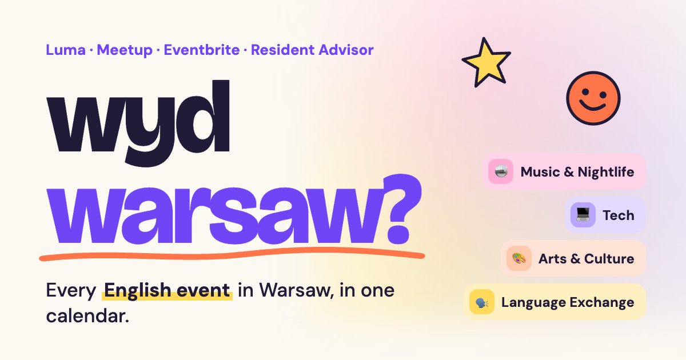
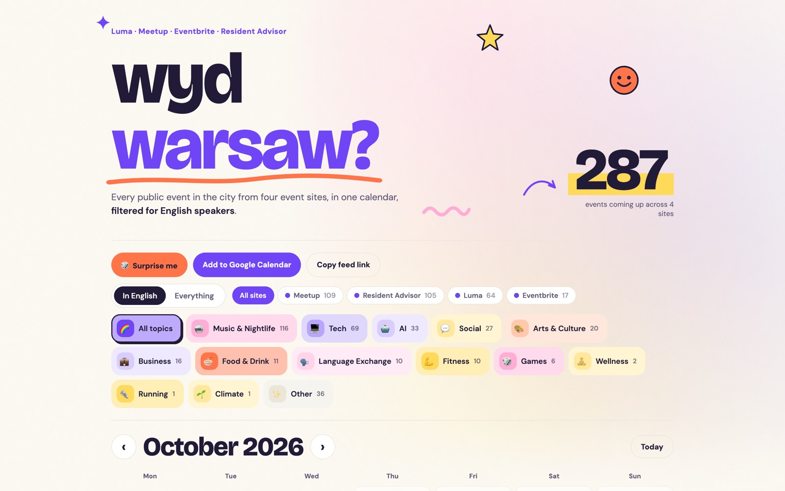
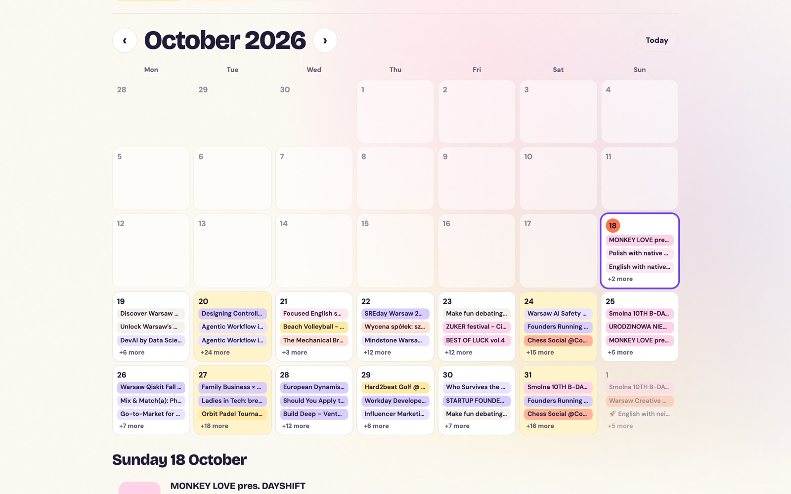
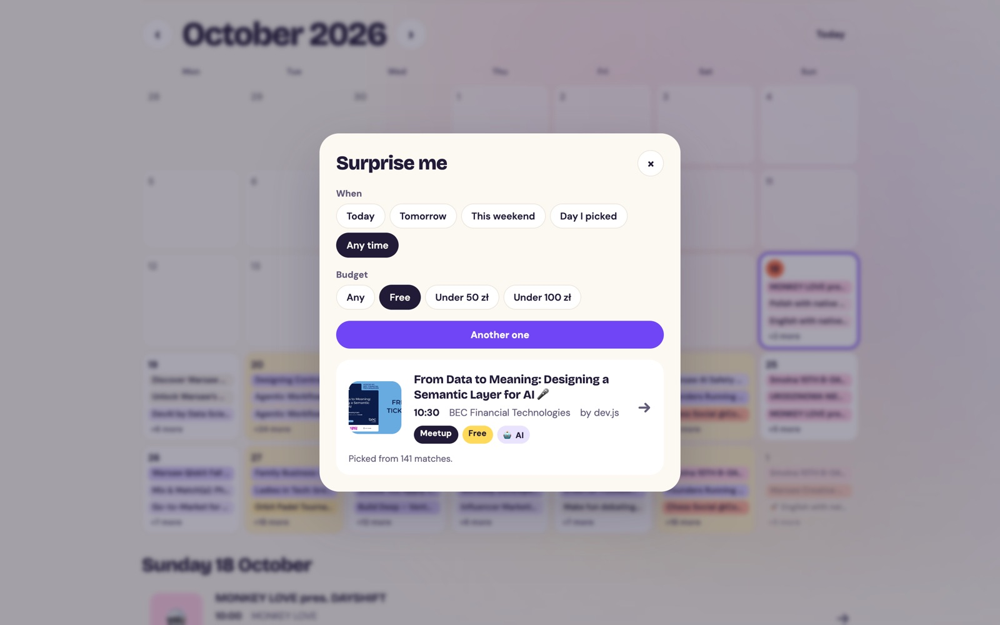
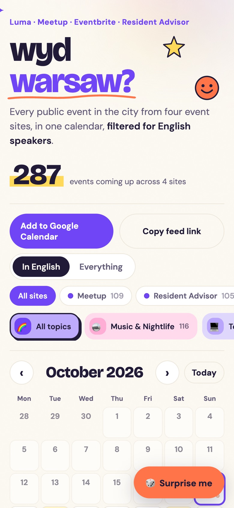
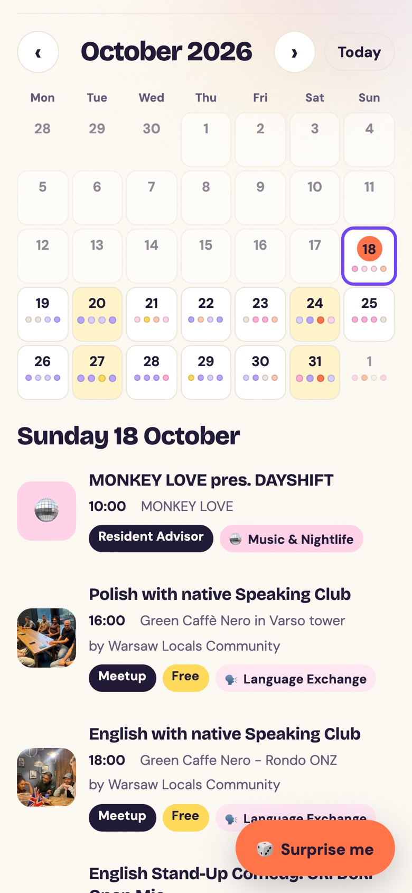
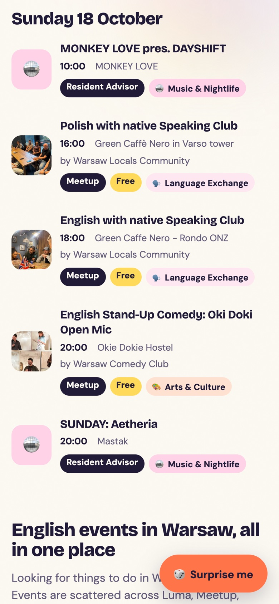
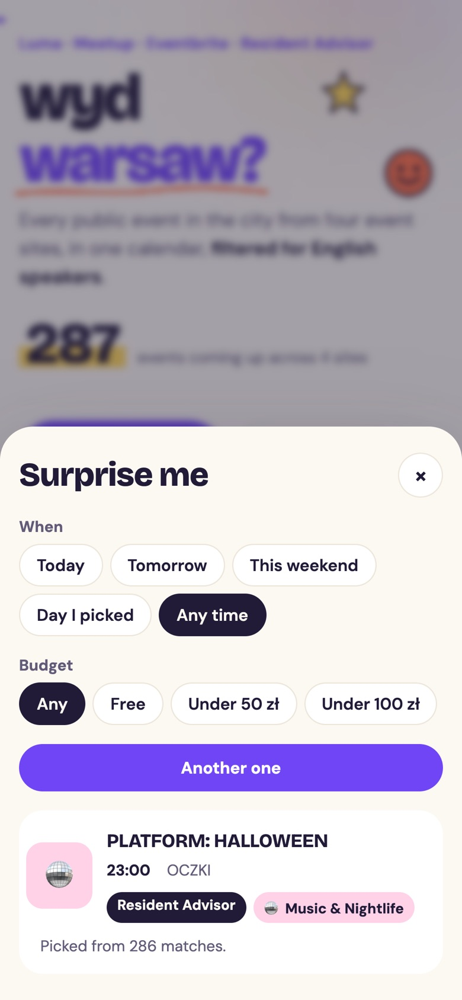

<div align="center">



# wyd warsaw?

**Every public English-friendly event in Warsaw, from four event sites, in one calendar.**

Meetups, stand-up comedy, language exchanges, tech talks, startup nights, art and club nights,<br>pulled from Luma, Meetup, Eventbrite and Resident Advisor every hour.

[**Open the calendar**](https://events-in-warsaw.vercel.app) · [Subscribe in Google Calendar](https://calendar.google.com/calendar/render?cid=webcal%3A%2F%2Fevents-in-warsaw.vercel.app%2Fwarsaw.ics) · [`.ics` feed](https://events-in-warsaw.vercel.app/warsaw.ics)


</div>

## Screenshots

<table>
  <tr>
    <td colspan="2"></td>
  </tr>
  <tr>
    <td width="50%"></td>
    <td width="50%"></td>
  </tr>
</table>

<p align="center">
  
  
  
  
</p>

## Why

Luma's Warsaw page is curated and leaves most events out, and plenty of events never make it to Luma at all. This pulls everything happening in the city from the sites people post to, keeps the ones in English, and puts them in one calendar you can browse or subscribe to.

## Features

- **Month calendar** you can swipe through (or use the arrows and keyboard), with busy days highlighted. Tap a day to see its events.
- **English filter** on by default, or switch to everything.
- **Filters** by site and by category. Each category has its own colour and icon.
- **Surprise me** picks a random event for a chosen day and budget, within your current filters.
- **Calendar feed** of the English events for Google or Apple Calendar, so new events turn up on their own.
- **Mobile first**: sideways-scrolling filters, a floating Surprise me button and a bottom sheet.

## Sources

| Site | How it's read | Good for |
|---|---|---|
| Luma | `api.lu.ma` geo search around Warsaw | Tech, startups, creative clubs |
| Meetup | `meetup.com/gql2` GraphQL | Language exchanges, comedy, dev meetups, sports |
| Eventbrite | the city page's embedded `__SERVER_DATA__` | Workshops, comedy, dance, networking |
| Resident Advisor | `ra.co/graphql` | Club nights and DJ sets |

All four are the unofficial endpoints each site's own website uses, so any of them can change without notice. If one breaks, the others keep working and the page footer shows which source is unavailable.

## How it works

- `lib/sources/*.js`: one reader per site. Each returns events in the same shape (name, start, end, venue, link, price, topics, English flag).
- `lib/events.js`: runs every source in parallel, merges events posted to several sites (same day, overlapping title), fills in topics, and builds the `.ics` feed.
- `lib/util.js`: shared helpers, including the English check and keyword topics.
- `api/feed.js`: serves `/events.json` for the page and `/warsaw.ics` for calendars. It keeps a snapshot in Vercel Blob and answers from it straight away; when the snapshot is over an hour old it refreshes from every source in the background, so visitors never wait for a refresh.
- `public/index.html`: the whole page, plain HTML, CSS and JS with no build step. It also remembers the last events in the browser so repeat visits draw instantly.
- `public/robots.txt`, `sitemap.xml`, `llms.txt`, `og.png`: search engines, AI assistants and link previews.

**English filter.** A word vote between common English and Polish words over the title and description. Bilingual events count as English if they have a proper English section or open in English. With too little text it falls back to the site's own language setting (Luma) or to whether the title uses Polish or non-Latin letters. Club nights from Resident Advisor count as English.

**Topics.** Luma's own categories where it has them. Everything else gets topics from keywords in the title and the start of the description, so expect the odd miss.

## Design

- Colours: electric purple `#7045F6` (brand), tangerine `#FF754A`, butter yellow `#FFD95A`, bubblegum pink `#FFADD5`, soft cream `#FCF9F2`, midnight ink `#211B38`. Tangerine, yellow and pink are only used as fills with ink text, since they're too light to read as text on cream.
- Fonts: Bricolage Grotesque for headings, DM Sans for everything else.
- Floating stickers and small animations stay still when the device has reduce motion turned on.

## Findability

- Title, description, canonical URL and a 1200×630 share image for link previews.
- JSON-LD: `WebSite`, an `FAQPage` matching the on-page FAQ, and an `ItemList` of upcoming `Event`s built from the live data.
- A crawlable intro and FAQ written around what people search for ("English events in Warsaw", "what's on this weekend", "free events in Warsaw").
- `robots.txt` welcomes search and AI crawlers, `sitemap.xml`, and `llms.txt` describing the data endpoints.

## Running it

```
npm install
vercel env pull .env.local   # gets BLOB_READ_WRITE_TOKEN
vercel dev
```

Deploy with `vercel deploy --prod`. The project isn't connected to GitHub yet, so pushing doesn't deploy.

## Check

```
node check.js
```

Runs the self-checks (English filter, Warsaw time conversion, duplicate detection) and then a live fetch from every source, failing if any source errors or an event appears twice.

## Limits

- Facebook events aren't included. They need a login and have no workable public access.
- Prices are only known for Luma and Meetup events, so Surprise me's budget options skip the rest.
- The calendar only shows upcoming events. Past events aren't kept.
- Hosts usually post two to four weeks ahead, so later months look quiet until they fill in.
